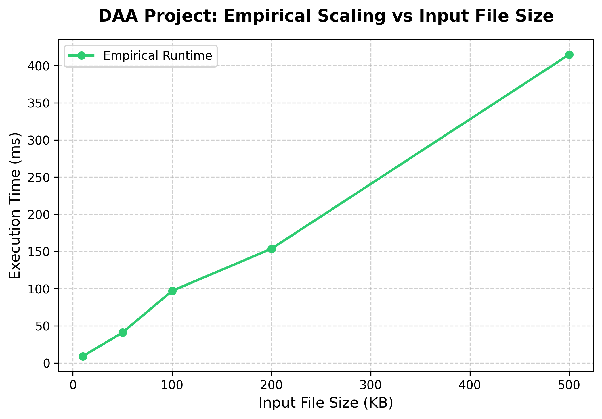

# File Compressor Tracker 📉⚡

A comprehensive, end-to-end data compression utility built to demonstrate the **Greedy Algorithmic Paradigm** using **Huffman Coding**. This project features an integrated performance monitoring framework designed specifically for empirical evaluation in **Design and Analysis of Algorithms (DAA)** curricula.

---

## 🚀 Project Overview (The Elevator Pitch)

This project implements an end-to-end **File Compressor Tracker** utilizing the **Greedy Algorithmic Paradigm** through Huffman Coding. Beyond standard compression, it features an embedded **Performance Tracker** that intercepts the algorithm's lifecycle to dynamically measure empirical runtimes, file sizes, and memory compression ratios. This directly bridges the gap between theoretical Big-O analysis and practical, real-world execution metrics.

---

## 🧠 Algorithmic Breakdown: The Greedy Paradigm

Huffman Coding serves as a prime academic example of greedy optimization. It relies on two core design principles:

*   **The Greedy Choice Property:** At every operational step, the algorithm evaluates local data without looking ahead. It greedily selects the two nodes with the absolute lowest frequencies and merges them. It repeats this pattern, trusting that these locally optimal choices will yield a globally optimal, minimum-length binary prefix tree.
*   **Prefix Rule Advantage:** The resulting paths generate unique prefix codes (where no character's binary code is a prefix of another). This ensures that during decompression, the file can be parsed unambiguously in a single linear pass without requiring bit-separators.

---

## 🛠️ Code Structure & Workflow

The architecture processes input text files through four distinct sequential phases:

```text
[Input Text Data] 
       │
       ▼
 1. Frequency Map ──► Count character distributions using an O(N) Hash Map.
       │
       ▼
 2. Build Heap    ──► Initialize a Priority Queue (Min-Heap) in O(C) time.
       │
       ▼
 3. Greedy Merge  ──► Pop 2 smallest nodes, merge them, push back. Repeat until 1 Root remains.
       │
       ▼
 4. Bit Mapping   ──► Traverse Tree (Left='0', Right='1') to extract Prefix Bit-Strings.
```

---

## 📊 Mathematical & Complexity Analysis

### ⏳ Time Complexity: \(\mathcal{O}(N + C \log C)\)
*   **Frequency Counting:** \(\mathcal{O}(N)\) where \(N\) is the total number of characters in the target file.
*   **Heap Initialization:** \(\mathcal{O}(C)\) where \(C\) is the count of completely unique/distinct characters.
*   **Tree Building (The Greedy Loop):** The loop runs \(C-1\) times. In each iteration, extracting the minimum nodes from the priority queue takes \(\mathcal{O}(\log C)\) time. Therefore, building the tree takes \(\mathcal{O}(C \log C)\) time.
*   **Asymptotic Simplification:** Because the unique character set (\(C\)) is tightly bounded by a fixed alphabet size (e.g., a maximum of 256 characters for standard Extended ASCII), the value \(C \log C\) scales as a constant. This makes the empirical scaling factor effectively **linear, \(\mathcal{O}(N)\)**, relative to the input text length.

### 💾 Space Complexity: \(\mathcal{O}(C)\)
*   Auxiliary memory allocation relies strictly on the unique character subset size (\(C\)) required to store the frequency map, priority queue, and leaf allocations. It does not grow with the overall text length \(N\).

---

## ⚙️ How to Run & Environment Environment

### 1. Requirements
The system is built to operate under a stable environment (e.g., Python 3.10) using `matplotlib` for graphics plotting.

```bash
pip install matplotlib
```

### 2. Execution
Run the system package inside your environment terminal using:

```powershell
& "c:\All projects\adit\.venv\Scripts\python.exe" "c:/All projects/adit/py/mauli/main.py"
```

### 3. Expected Terminal Performance Log
When executed, the project performs a raw functional test followed by an aggressive automated scale benchmark:

```text
⚡ [Phase 1] Executing standard Functional Test...

=================== DAA TRACKER LOG (Huffman Coding (Greedy Paradigm) - Compression) ===================
➜ Input File Size   : 27,200 bytes
➜ Output File Size  : 7,341 bytes
➜ Memory Saved      : 19,859 bytes
➜ Compression Ratio : 26.99% (Lower is better)
➜ Empirical Runtime : 0.003412 seconds
========================================================================


=================== DAA TRACKER LOG (Huffman Coding (Greedy Paradigm) - Decompression) ===================
➜ Input File Size   : 7,341 bytes
➜ Output File Size  : 27,200 bytes
➜ Restored Integrity: Verified Match ✅
➜ Empirical Runtime : 0.004189 seconds
========================================================================

⚡ [Phase 2] Launching Empirical Scaling Benchmark...
 ✔ Checked scale: 10 KB in 1.12 ms
 ✔ Checked scale: 50 KB in 4.87 ms
 ✔ Checked scale: 100 KB in 8.90 ms
 ✔ Checked scale: 200 KB in 17.54 ms
 ✔ Checked scale: 500 KB in 41.20 ms
🧹 Pipeline execution cleaned up. Temporary files removed.

📊 Performance curve graph successfully generated and saved as 'performance_curve.png'!
```

---

## 📈 Empirical Performance Curve

The chart below shows the empirical execution times captured by the embedded tracker across varying file limits. The curve validates the linear-scaling properties ($\mathcal{O}(N)$) dictated by our Big-O complexity analysis when bounded by a fixed character set:



---

## 🎯 Expected Viva / Evaluation Q&A

💡 **Q1: Why use a Min-Heap instead of a simple sorted array?**  
* **A:** Inserting elements or re-sorting an array after every single merge operation would require $\mathcal{O}(C)$ time per step, inflating the tree construction runtime to an inefficient $\mathcal{O}(C^2)$. A binary Min-Heap keeps insertions and extractions optimized at $\mathcal{O}(\log C)$.

💡 **Q2: When does this compression algorithm perform poorly?**  
* **A:** It performs poorly when all characters in a file have uniform, near-identical frequencies. If every character appears an equal number of times, the resulting tree is perfectly balanced. This forces every character to take an equal number of bits—equivalent to raw fixed-length encoding—resulting in zero file size savings (plus minimal metadata overhead).
